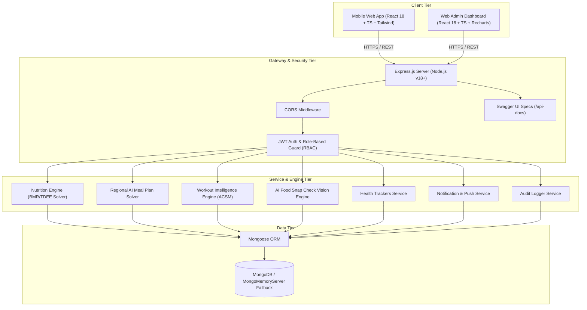
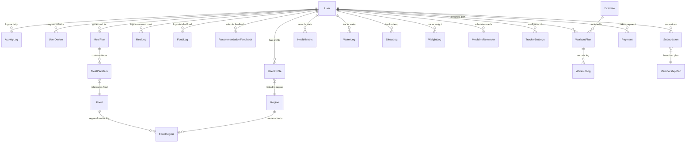
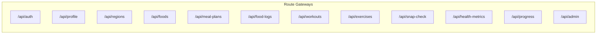

# Exhaustive Technical Knowledge Transfer (KT) Document — NutriRegion

**Project Title:** NutriRegion (Regional AI Diet & Fitness Assistant)  
**Workspace Path:** `c:\Users\bhush\OneDrive\Desktop\FitnessApp`  
**Document Classification:** Master Technical Handover & Intern Knowledge Transfer  
**Date of Completion:** September 7, 2026  
**Document Version:** 2.0 (Production Blueprint)  

---

## 📌 1. Project Overview & Business Domain

**NutriRegion** is an end-to-end, enterprise-grade personalized diet, nutrition, and exercise intelligence platform engineered specifically for regional Indian dietary preferences and evidence-informed fitness training.

### Core Problem Solved
Generic fitness applications rely heavily on Western food databases (e.g., oats, avocado toast, chicken breast) and standardized gym workouts. Indian diets feature rich regional diversity (e.g., Maharashtrian Poha, Misal, Bhakri, Dal Tadka, South Indian Dosa/Idli, Gujarati Dhokla, North Indian Parathas) with intricate macro variations, cooking oils, and local availability. Furthermore, fitness routines must safely adjust to user constraints such as home workouts without equipment versus gym environments.

### Core Objectives Delivered
1. **Dynamic Onboarding & Target Calculation**: Mifflin-St Jeor equation deriving Basal Metabolic Rate (BMR), Total Daily Energy Expenditure (TDEE), and macro targets tailored to weight loss, muscle gain, or maintenance goals.
2. **Region-Aware Multi-Variable Recommendation Engine**: Algorithms that score regional foods based on macro fit, local availability (1–10 scale), authentic recipes, user diet choices (`veg`, `non_veg`, `eggetarian`), and strict allergy exclusions.
3. **Automated 5-Slot Meal Plan Solver**: Solves daily macro requirements across 5 distinct meal slots (Breakfast 25%, Mid Morning 10%, Lunch 35%, Evening Snack 10%, Dinner 20%) by dynamically scaling recipe portion weights ($g$).
4. **Recommendation Feedback Learning Loop**: Like, dislike, consumed, and skip signals update user preference matrices to continuously refine future meal suggestions.
5. **Workout Intelligence Engine (ACSM 2026 Compliant)**: Generates structured workout routines across 10 taxonomies, incorporating strict equipment safety checks (rejecting equipment exercises for bodyweight users) and exercise replacement solvers.
6. **Live Workout Tracker & Anatomical Muscle Map**: Real-time tracking modal featuring set/rep/weight input, audio rest timers, and interactive SVG muscle maps highlighting targeted muscle groups.
7. **Computer Vision AI Food Snap Check**: Simulated vision recognition engine estimating macros, ingredients, and confidence scores from uploaded meal photos.
8. **Multi-Health Trackers**: Dedicated tracking systems for Water Intake, Sleep Duration/Quality, Daily Step Counts, Body Weight Trajectory, and Scheduled Medicine Reminders.
9. **Full Administrative Management Portal**: Independent React web dashboard for platform metrics, user access controls (`active` / `blocked`), food/exercise master database CRUD, and security audit logs.

---

## 📁 2. Workspace Directory Structure

```text
FitnessApp/
├── .env.example                               # Environment configuration template
├── README.md                                   # Quickstart guide
├── MOBILE_TESTING.md                          # Mobile feature test suite guide
├── backend/                                   # Express.js + TypeScript API Backend
│   ├── package.json
│   ├── tsconfig.json
│   └── src/
│       ├── app.ts                             # Server entry point & DB connection fallback
│       ├── seed.ts                            # Full database seeder script
│       ├── config/                            # DB, JWT, and CORS configs
│       ├── models/                            # 36 Mongoose Schemas (User, Food, Exercise, etc.)
│       ├── routes/                            # 18 Express API Router modules
│       ├── controllers/                       # HTTP Controller handlers
│       ├── middleware/                        # Auth JWT, RBAC Guard, Error Handlers
│       ├── services/                          # 23 Core Business Engines & Solvers
│       └── tests/                             # Integration & Unit Test Suites
├── mobile/                                    # React + TypeScript + Tailwind Mobile User App
│   ├── package.json
│   ├── vite.config.ts
│   └── src/
│       ├── App.tsx                            # Primary router & tab navigator root
│       ├── main.tsx                           # React DOM mount point
│       ├── types.ts                           # Mobile TypeScript Interfaces
│       ├── screens/                           # 17 Main User Application Screens
│       ├── components/                        # 37 Modal & Dynamic UI Components
│       └── services/                          # Mobile API client services
├── admin/                                     # React + TypeScript Web Admin Dashboard
│   ├── package.json
│   ├── vite.config.ts
│   └── src/
│       ├── App.tsx                            # Admin dashboard root layout
│       ├── pages/                             # 8 Management Views (Users, Foods, Exercises, etc.)
│       ├── components/                        # Recharts & UI Components
│       └── services/                          # Admin API client services
└── docs/                                      # System Architecture & API Docs
    ├── ARCHITECTURE.md                        # Architecture & flow diagrams
    ├── DATABASE.md                            # Database schema specifications
    ├── API.md                                 # REST API specification guide
    ├── WORKOUT_INTELLIGENCE_ENGINE.md         # Workout engine specification
    ├── FIXED_WORKOUT_EXERCISE_LIBRARY.md      # Exercise catalog details
    └── KNOWLEDGE_TRANSFER_DOCUMENT.md         # Master KT document copy
```

---

## 🏗️ 3. Comprehensive System Architecture



### Stack Matrix

| Dimension | Mobile App | Backend API | Web Admin Portal |
| :--- | :--- | :--- | :--- |
| **Language** | TypeScript | TypeScript | TypeScript |
| **Framework** | React 18 (Vite) | Express.js (Node.js v18) | React 18 (Vite) |
| **Styling** | Tailwind CSS, Lucide Icons | N/A | Tailwind CSS |
| **Data Viz** | Custom SVG / Canvas | N/A | Recharts |
| **State/Storage**| React State, LocalStorage | MongoDB / Mongoose | React State, LocalStorage |
| **Auth** | Bearer JWT Token | `jsonwebtoken`, `bcryptjs` | Bearer JWT Token |
| **Dev DB** | N/A | `mongodb-memory-server` | N/A |

---

## 🗄️ 4. Database Collections & Schema Deep-Dive (All 36 Collections)

Below is the complete architectural reference for all 36 Mongoose collections used in `backend/src/models/`.



### Collection Specifications

#### 1. `User` (`User.ts`)
- `_id`: ObjectId
- `name`: String (Required, trimmed)
- `email`: String (Required, unique, lowercase)
- `password`: String (Required, bcrypt hash)
- `role`: String Enum (`'user'`, `'admin'`, `'super_admin'`), Default: `'user'`
- `status`: String Enum (`'active'`, `'blocked'`), Default: `'active'`
- `lastLogin`: Date
- `createdAt`, `updatedAt`: Timestamps

#### 2. `UserProfile` (`UserProfile.ts`)
- `user`: ObjectId -> `User` (Required, unique index)
- `age`: Number (Required, min: 10, max: 120)
- `gender`: String Enum (`'male'`, `'female'`, `'other'`)
- `heightCm`: Number (Required, in cm)
- `weightKg`: Number (Required, in kg)
- `activityLevel`: String Enum (`'sedentary'`, `'lightly_active'`, `'moderately_active'`, `'very_active'`)
- `goal`: String Enum (`'weight_loss'`, `'muscle_gain'`, `'maintenance'`)
- `dietType`: String Enum (`'veg'`, `'non_veg'`, `'eggetarian'`), Default: `'veg'`
- `allergies`: Array of Strings (`['peanuts', 'dairy', 'gluten', 'seafood']`)
- `region`: ObjectId -> `Region` (Required)
- `targetCalories`: Number (Calculated by Mifflin-St Jeor)
- `targetProteinG`: Number (Calculated: 2.0g/kg)
- `targetCarbsG`: Number (Calculated)
- `targetFatsG`: Number (Calculated)

#### 3. `Region` (`Region.ts`)
- `name`: String (Required, e.g. "Mumbai", "Pune", "Ahmedabad")
- `state`: String (Required, e.g. "Maharashtra", "Gujarat", "Delhi")
- `country`: String (Default: "India")
- `isActive`: Boolean (Default: true)

#### 4. `Food` (`Food.ts`)
- `name`: String (Required)
- `localName`: String (Regional language name)
- `category`: String Enum (`'breakfast'`, `'lunch'`, `'dinner'`, `'snack'`, `'beverage'`)
- `dietType`: String Enum (`'veg'`, `'non_veg'`, `'eggetarian'`)
- `servingSizeG`: Number (Default: 100)
- `calories`: Number (kcal per 100g)
- `proteinG`: Number (grams per 100g)
- `carbsG`: Number (grams per 100g)
- `fatsG`: Number (grams per 100g)
- `fiberG`: Number (grams per 100g)
- `ingredients`: Array of Strings
- `recipeInstructions`: Array of Strings
- `imageUrl`: String

#### 5. `FoodRegion` (`FoodRegion.ts`)
- `food`: ObjectId -> `Food` (Required)
- `region`: ObjectId -> `Region` (Required)
- `availabilityScore`: Number (1–10 scale)
- `authenticityScore`: Number (1–10 scale)
- `averagePriceINR`: Number

#### 6. `MealPlan` & `MealPlanItem` (`MealPlan.ts`, `MealPlanItem.ts`)
- **`MealPlan`**: `user` (Ref User), `date` (Date), `totalCalories` (Number), `totalProtein` (Number), `totalCarbs` (Number), `totalFats` (Number), `isCustomized` (Boolean).
- **`MealPlanItem`**: `mealPlan` (Ref MealPlan), `slot` Enum (`'breakfast'`, `'mid_morning'`, `'lunch'`, `'evening_snack'`, `'dinner'`), `food` (Ref Food), `portionGrams` (Number), `calculatedCalories` (Number), `explanation` (String).

#### 7. `RecommendationFeedback` (`RecommendationFeedback.ts`)
- `user`: ObjectId -> `User`
- `food`: ObjectId -> `Food`
- `action`: String Enum (`'liked'`, `'disliked'`, `'consumed'`, `'skipped'`)
- `feedbackReason`: String
- `createdAt`: Timestamp

#### 8. `Exercise` (`Exercise.ts`)
- `name`: String (Required, unique)
- `category`: String Enum (`'resistance'`, `'cardio'`, `'hiit'`, `'core'`, `'mobility'`)
- `primaryMuscle`: String Enum (`'chest'`, `'lats'`, `'quads'`, `'glutes'`, `'hamstrings'`, `'shoulders'`, `'biceps'`, `'triceps'`, `'abs'`, `'calves'`)
- `secondaryMuscles`: Array of Strings
- `equipment`: String Enum (`'Bodyweight'`, `'Dumbbell'`, `'Barbell'`, `'Cable'`, `'Machine'`, `'Kettlebell'`, `'Resistance Band'`)
- `difficulty`: String Enum (`'beginner'`, `'intermediate'`, `'advanced'`)
- `movementPattern`: String (`'horizontal_push'`, `'vertical_push'`, `'squat'`, `'hinge'`, etc.)
- `instructions`: Array of Strings
- `substituteExerciseIds`: Array of ObjectIds -> `Exercise`
- `imageUrl`, `videoUrl`: Strings

#### 9. `WorkoutPlan` & `WorkoutLog` (`WorkoutPlan.ts`, `WorkoutLog.ts`)
- **`WorkoutPlan`**: `user` (Ref User), `title` (String), `focusArea` (String), `taxonomy` (String), `difficulty` (String), `estimatedDurationMin` (Number), `exercises` (Array of Exercise configs).
- **`WorkoutLog`**: `user` (Ref User), `workoutPlan` (Ref WorkoutPlan), `durationSec` (Number), `totalCaloriesBurned` (Number), `completedExercises` (Array of set/rep records), `completedAt` (Date).

#### 10. `SnapCheckResult` (`SnapCheckResult.ts`)
- `user`: ObjectId -> `User`
- `imageUrl`: String
- `detectedFoodName`: String
- `confidenceScore`: Number (0–100%)
- `estimatedMacros`: `{ calories: Number, proteinG: Number, carbsG: Number, fatsG: Number }`
- `detectedIngredients`: Array of Strings

#### 11. Additional Health & System Collections (12–36)
- **`HealthMetric`**, **`WaterLog`**, **`SleepLog`**, **`WeightLog`**, **`ActivityLog`**, **`MedicineReminder`**, **`TrackerSettings`**: Daily health metrics tracking schemas.
- **`Notification`**, **`NotificationPreferences`**, **`UserDevice`**: Push notification queue and token registry.
- **`Trainer`**, **`TrainerAssignment`**, **`MembershipPlan`**, **`Subscription`**, **`Payment`**: Coaching subscription and monetization models.
- **`Recipe`**, **`FavoriteFood`**, **`OtpRecord`**, **`AuditLog`**: Master recipes, bookmarks, OTP validation, and admin security logs.

---

## ⚙️ 5. Core Mathematical Engines & Algorithms

### A. Mifflin-St Jeor BMR & TDEE Solver (`nutritionService.ts`)

```typescript
export function calculateBMR(stats: {
  gender: 'male' | 'female' | 'other';
  weightKg: number;
  heightCm: number;
  age: number;
}): number {
  const genderOffset = stats.gender === 'female' ? -161 : 5;
  return 10 * stats.weightKg + 6.25 * stats.heightCm - 5 * stats.age + genderOffset;
}

export function calculateTDEE(bmr: number, activityLevel: string): number {
  const multipliers: Record<string, number> = {
    sedentary: 1.2,
    lightly_active: 1.375,
    moderately_active: 1.55,
    very_active: 1.725
  };
  return bmr * (multipliers[activityLevel] || 1.2);
}

export function calculateTargetMacros(tdee: number, goal: string, weightKg: number) {
  let targetCalories = tdee;
  if (goal === 'weight_loss') targetCalories -= 500;
  else if (goal === 'muscle_gain') targetCalories += 400;

  const proteinG = Math.round(weightKg * 2.0); // 2.0g per kg
  const fatsG = Math.round((targetCalories * 0.25) / 9); // 25% of calories
  const carbsG = Math.round((targetCalories - (proteinG * 4 + fatsG * 9)) / 4);

  return { targetCalories, proteinG, carbsG, fatsG };
}
```

### B. Multi-Variable Regional AI Recommendation Solver (`personalizationEngine.ts`)

```typescript
export function scoreFoodItem(
  food: IFood,
  foodRegion: IFoodRegion,
  userProfile: IUserProfile,
  feedbackHistory: IRecommendationFeedback[]
): number {
  // 1. Allergy Exclusion (Hard Guard)
  const hasAllergy = userProfile.allergies.some(allergy =>
    food.ingredients.some(ing => ing.toLowerCase().includes(allergy.toLowerCase()))
  );
  if (hasAllergy) return 0; // Immediate exclusion

  // 2. Diet Type Exclusion (Hard Guard)
  if (userProfile.dietType === 'veg' && food.dietType !== 'veg') return 0;
  if (userProfile.dietType === 'eggetarian' && food.dietType === 'non_veg') return 0;

  // 3. Macro Alignment Score (35%)
  const macroScore = calculateMacroAlignment(food, userProfile);

  // 4. Regional Availability Score (25%)
  const regionalScore = (foodRegion.availabilityScore / 10) * 100;

  // 5. User Preference Match (20%)
  const prefScore = userProfile.dietType === food.dietType ? 100 : 70;

  // 6. Historical Feedback Score (20%)
  const userFeedback = feedbackHistory.filter(f => f.food.toString() === food._id.toString());
  let feedbackScore = 50; // Neutral default
  if (userFeedback.some(f => f.action === 'liked' || f.action === 'consumed')) feedbackScore = 100;
  if (userFeedback.some(f => f.action === 'disliked')) feedbackScore = 10;

  return 0.35 * macroScore + 0.25 * regionalScore + 0.20 * prefScore + 0.20 * feedbackScore;
}
```

### C. 5-Slot Portion Weight Solver (`mealPlanGenerator.ts`)

$$\text{Slot Target Calories} = \text{Target Calories} \times \text{Slot Percentage}$$
$$\text{Portion Weight } (g) = \text{Clamp}\left( \frac{\text{Slot Target Calories}}{\text{Food Calories per 100g}} \times 100, \, 50g, \, 600g \right)$$

- **Slot Percentages**: Breakfast ($25\%$), Mid Morning ($10\%$), Lunch ($35\%$), Evening Snack ($10\%$), Dinner ($20\%$).

### D. Equipment Safety Validator (`workoutValidator.ts`)

```typescript
export function validateWorkoutEquipment(workout: IWorkoutPlan, userEquipment: string[]): boolean {
  const allowedEquipmentSet = new Set(userEquipment);

  for (const exercise of workout.exercises) {
    if (!allowedEquipmentSet.has(exercise.equipment)) {
      // Reject workout if equipment is not owned by user (e.g. Bodyweight user getting Barbell)
      return false;
    }
  }
  return true;
}
```

---

## 📡 6. Complete REST API Specifications (18 Route Modules)

Base URL: `http://localhost:5000/api`  
Interactive OpenAPI / Swagger UI: `http://localhost:5000/api-docs`



### Selected Route Endpoints

#### 1. `POST /api/auth/register`
- **Description**: Registers a new user account.
- **Request Body**:
  ```json
  {
    "name": "Rahul Sharma",
    "email": "rahul@example.com",
    "password": "password123"
  }
  ```
- **Response (`201 Created`)**:
  ```json
  {
    "token": "eyJhbGciOiJIUzI1NiIsInR5cCI6IkpXVCJ9...",
    "user": { "id": "60d5ec49f1b2c81234567890", "name": "Rahul Sharma", "email": "rahul@example.com", "role": "user" }
  }
  ```

#### 2. `POST /api/auth/login`
- **Description**: Authenticates user and returns JWT token.
- **Request Body**: `{ "email": "rahul@example.com", "password": "password123" }`
- **Response (`200 OK`)**: Token & user metadata.

#### 3. `GET /api/profile`
- **Headers**: `Authorization: Bearer <JWT_TOKEN>`
- **Response (`200 OK`)**: User stats, calculated BMR, TDEE, and daily target macros.

#### 4. `POST /api/meal-plans/generate`
- **Headers**: `Authorization: Bearer <JWT_TOKEN>`
- **Response (`200 OK`)**: 5-slot generated meal plan object with portion weights ($g$), macros, and explanations.

#### 5. `GET /api/workouts/today`
- **Headers**: `Authorization: Bearer <JWT_TOKEN>`
- **Response (`200 OK`)**: Target daily workout plan matching user difficulty and equipment constraints.

#### 6. `POST /api/snap-check/analyze`
- **Headers**: `Authorization: Bearer <JWT_TOKEN>`
- **Request Body**: `{ "image": "data:image/jpeg;base64,..." }`
- **Response (`200 OK`)**: Image analysis object with detected food name, confidence score, and estimated macros.

#### 7. `GET /api/admin/metrics` (Admin Only)
- **Headers**: `Authorization: Bearer <JWT_TOKEN>`
- **Response (`200 OK`)**: Total users, total active subscriptions, regional distribution breakdown, recent security audit logs.

---

## 📱 7. Front-End Component Architecture

### Mobile App Screens (`mobile/src/screens/`)
1. **`AuthScreen.tsx`**: Tabbed Login / Registration / Phone OTP authentication screen.
2. **`OnboardingScreen.tsx`**: Multi-step wizard collecting age, height, weight, gender, and activity level.
3. **`GoalScreen.tsx`**: Goal selection interface (Fat Loss, Muscle Gain, Maintenance).
4. **`PreferencesScreen.tsx`**: Dietary preferences (`veg`, `non_veg`, `eggetarian`) & allergy toggles.
5. **`RegionScreen.tsx`**: Interactive GPS / manual Indian regional hub selector.
6. **`HomeScreen.tsx`**: Primary dashboard displaying daily calorie ring, macro progress bars, meal slot preview, and workout shortcut.
7. **`MealPlanScreen.tsx`**: Full 5-slot meal plan view with "Why Recommended" checklist cards.
8. **`WorkoutScreen.tsx`**: Daily workout preview screen with category filters and "Start Live Workout" launcher.
9. **`WorkoutStudioScreen.tsx`**: Workout category browser and library search.
10. **`HealthDashboardScreen.tsx`**: Central multi-tracker overview displaying cards for water, sleep, steps, weight, and medicine reminders.
11. **`SearchMealsScreen.tsx`**: Master food database search & custom logging screen.
12. **`FoodDetailsScreen.tsx`**: Detailed food macro breakdown and regional recipe instructions.
13. **`ProgressScreen.tsx`**: Analytical trend line charts for body weight, calories consumed, and protein compliance.
14. **`ProfileScreen.tsx`**: User profile management and physical stats update.
15. **`TrainerScreen.tsx`**: Personal trainer coaching assignment screen.
16. **`SubscriptionScreen.tsx`**: Premium membership plan selection and payment checkout.
17. **`ExerciseDetailModal.tsx`**: Exercise execution instructions and substitute options modal.

### Key Dynamic Components (`mobile/src/components/`)
- **`LiveWorkoutTrackerModal.tsx`**: Full-screen modal guiding live workout execution with countdown rest timer, set/rep recorder, and audio triggers.
- **`AnatomicalMuscleMap.tsx`**: Interactive SVG/Canvas graphic highlighting primary and secondary targeted muscle groups during workout execution.
- **`SnapCheckModal.tsx`**: Camera simulator component processing photo uploads and displaying AI macro estimates.
- **`WaterTrackerModal.tsx`**, **`SleepTrackerModal.tsx`**, **`StepsTrackerModal.tsx`**, **`WeightTrackerModal.tsx`**, **`MedicineTrackerModal.tsx`**: Dedicated health logging interfaces.
- **`AddFoodModal.tsx`**, **`ReplaceMealModal.tsx`**, **`ModifyMealModal.tsx`**: Meal customization modals.

---

## 💻 8. Web Admin Portal Overview (`admin/`)

The web admin dashboard is a standalone React application optimized for platform managers and super admins.

### Pages & Capabilities
- **`DashboardOverview.tsx`**: Key Performance Indicator (KPI) metric cards (Total Users, Active Subscriptions, Food Catalog Count), User Growth line chart, and Regional Distribution donut chart.
- **`UsersManager.tsx`**: User registry table supporting instant status toggling (`active` / `blocked`), role elevation, and profile inspection.
- **`FoodsManager.tsx`**: Full CRUD portal for adding regional foods, setting per-100g macro breakdowns, and configuring regional availability scores ($1\text{--}10$).
- **`ExercisesManager.tsx`**: Master exercise database manager for defining muscle targets, equipment rules, and substitute exercise pairings.
- **`RegionsManager.tsx`**: Regional hub configuration manager.
- **`MembershipsManager.tsx`**: Subscription pricing tiers and discount plan editor.
- **`TrainersManager.tsx`**: Personal trainer profile verification and client assignment matrix.
- **`AuditLogsView.tsx`**: Real-time security audit log viewer recording administrative actions and status updates.

---

## 💡 9. Technical Challenges & Architectural Solutions

### 1. In-Memory Zero-Config Database Fallback
- **Problem**: Testing backend APIs required developers to install and maintain a local MongoDB daemon, causing environment friction.
- **Solution**: Implemented an automated database connection fallback in [`backend/src/app.ts`](file:///c:/Users/bhush/OneDrive/Desktop/FitnessApp/backend/src/app.ts). If `MONGODB_URI` connection fails, the server automatically starts `MongoMemoryServer` in-memory and runs [`seed.ts`](file:///c:/Users/bhush/OneDrive/Desktop/FitnessApp/backend/src/seed.ts) to populate authentic regional test data out-of-the-box.

### 2. Equipment Safety Violation Prevention
- **Problem**: Early versions of the workout solver occasionally recommended barbell squat routines to home users who selected bodyweight-only equipment.
- **Solution**: Engineered a strict validation filter in [`workoutValidator.ts`](file:///c:/Users/bhush/OneDrive/Desktop/FitnessApp/backend/src/services/workoutValidator.ts) that executes a set-intersection check between exercise equipment demands and user equipment ownership before serving any routine.

### 3. Realistic Portion Weight Scaling
- **Problem**: Unbounded portion scaling to hit exact macro goals resulted in unfeasible meal recommendations (e.g. $1,200g$ of cooked rice in a single lunch slot).
- **Solution**: Constrained portion scaling algorithm in [`mealPlanGenerator.ts`](file:///c:/Users/bhush/OneDrive/Desktop/FitnessApp/backend/src/services/mealPlanGenerator.ts) within realistic weight boundaries ($50g \text{ to } 600g$) and introduced secondary item balance logic.

### 4. High-Performance SVG Muscle Map Rendering
- **Problem**: Dynamic canvas rendering of muscle groups on mobile devices led to frame drops during set transitions.
- **Solution**: Developed lightweight SVG anatomical path component [`AnatomicalMuscleMap.tsx`](file:///c:/Users/bhush/OneDrive/Desktop/FitnessApp/mobile/src/components/AnatomicalMuscleMap.tsx) driven purely by declarative React state props (`primaryMuscle`, `secondaryMuscles`).

---

## 🛠️ 10. Setup, Run & Testing Guide

### Step 1: Environment Setup
Create a `.env` file in the root workspace directory:
```env
PORT=5000
MONGODB_URI=mongodb://localhost:27017/fitnessapp
JWT_SECRET=super_secret_jwt_key_nutriregion_2026
NODE_ENV=development
```

### Step 2: Running Backend Server
```bash
cd backend
npm install
npm run dev
```
- Server endpoint: `http://localhost:5000`
- API Health status: `http://localhost:5000/api/health`
- Swagger UI Specs: `http://localhost:5000/api-docs`

### Step 3: Running Mobile App
```bash
cd mobile
npm install
npm run dev
```
- Access Mobile UI at `http://localhost:3000`

### Step 4: Running Web Admin Portal
```bash
cd admin
npm install
npm run dev
```
- Access Admin Portal at `http://localhost:3001`

### Test Credentials
- **Demo User Account**: Email `rahul@example.com` | Password `password123`
- **Admin Account**: Email `admin@fitnessapp.com` | Password `password123`

---

## 📋 11. Handover Action Plan & Next Steps

1. **Production Database Migration**: Configure production MongoDB Atlas cluster URI in environment variables and transition off MongoMemoryServer fallback.
2. **Vision Model Integration**: Connect `snapCheckService.ts` to hosted PyTorch/YOLO server or Google Cloud Vision API endpoint for production image parsing.
3. **FCM Push Credentials**: Register Firebase Cloud Messaging project keys in `fcmService.ts` for native APNs/FCM mobile push delivery.
4. **Wearable SDK Integration**: Implement Native Bridges for Apple HealthKit and Google Health Connect for step count sync.

---
*End of Master Technical Knowledge Transfer Document.*
