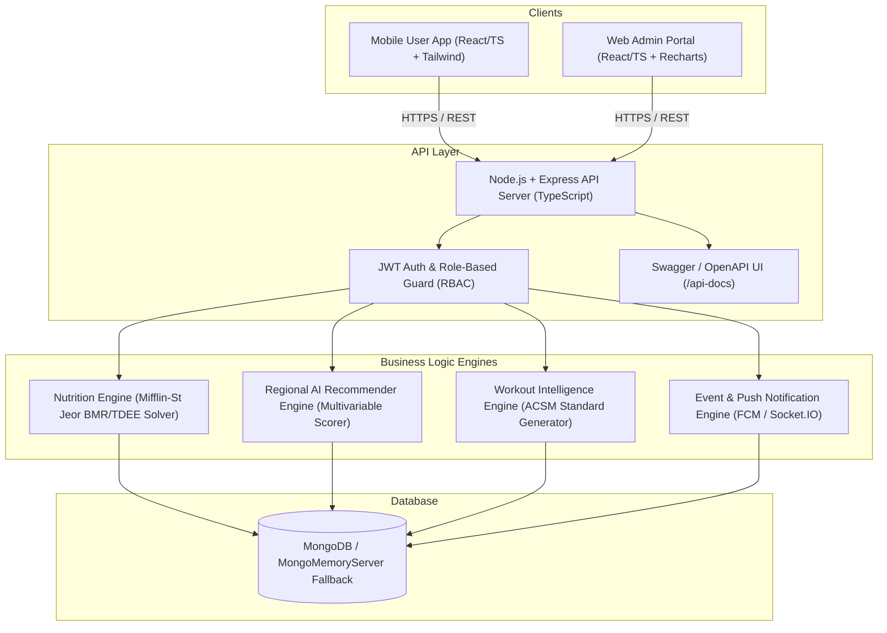
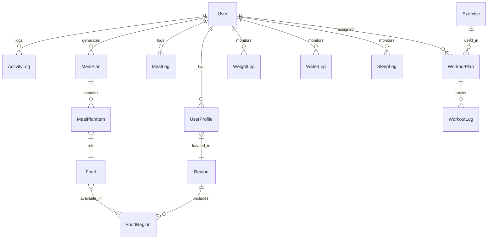

# Comprehensive Knowledge Transfer (KT) Document — NutriRegion

**Project Name:** NutriRegion (Regional AI Diet & Fitness Assistant)  
**Repository Path:** `c:\Users\bhush\OneDrive\Desktop\FitnessApp`  
**Document Type:** Intern Handover & Technical Knowledge Transfer  
**Date:** September 7, 2026  

---

## 📋 Executive Summary

**NutriRegion** is a full-stack, enterprise-ready regional personalized diet and fitness assistant application. It addresses regional Indian dietary habits, local food availability, cultural meal structures, dynamic workout generation based on ACSM guidelines, real-time live exercise tracking, interactive anatomical muscle mapping, and administrative platform management.

The platform comprises three primary sub-systems:
1. **Backend API Service**: Node.js + Express + TypeScript with Mongoose/MongoDB, auto-seeding, zero-config MongoMemoryServer fallback, and Swagger documentation.
2. **Mobile User Application**: React + TypeScript + Tailwind CSS mobile web app featuring automated meal plan generation, workout studio with live set/rep tracking, health trackers, food snap checking, and progress analytics.
3. **Web Admin Dashboard**: React + TypeScript + Recharts dashboard for managing users, food databases, exercise libraries, regional hubs, subscriptions, and security audit logs.

---

## 🏗️ System Architecture & Technology Stack



### Technology Breakdown

| Component | Stack / Library | Purpose |
| :--- | :--- | :--- |
| **Backend Runtime** | Node.js (v18+), Express.js, TypeScript | Core REST API web server and execution runtime |
| **Database & ORM** | MongoDB, Mongoose, MongoMemoryServer | Data persistence with embedded in-memory fallback |
| **Authentication** | JWT (jsonwebtoken), bcryptjs | Secure token-based auth and password hashing |
| **Mobile Frontend** | React, TypeScript, Vite, Tailwind CSS, Lucide Icons | Responsive mobile UI with glassmorphism aesthetics |
| **Admin Dashboard** | React, TypeScript, Recharts, Tailwind CSS | Management portal with analytical visual charts |
| **API Documentation** | Swagger UI Express, swagger-jsdoc | Interactive API specs (`/api-docs`) |

---

## 🗄️ Database Schema & Data Models

The application utilizes **36 Mongoose collections**. Key schemas and their relationships include:



### Key Models Overview

1. **`User`** (`User.ts`): Credentials, role (`user`, `admin`, `super_admin`), status (`active`, `blocked`), last login timestamp.
2. **`UserProfile`** (`UserProfile.ts`): Age, gender, height ($cm$), weight ($kg$), activity level (`sedentary`, `lightly_active`, `moderately_active`, `very_active`), goal (`weight_loss`, `muscle_gain`, `maintenance`), daily target calories, protein ($g$), carbs ($g$), fats ($g$), allergies, diet type (`veg`, `non_veg`, `eggetarian`).
3. **`Region`** (`Region.ts`): Regional hierarchy — Country, State, City, Region Name (e.g. Maharashtra -> Mumbai/Pune/Nagpur/Nashik).
4. **`Food` & `FoodRegion`** (`Food.ts`, `FoodRegion.ts`): Master food database (per 100g macros, ingredients, recipe instructions) joined with regional availability scores (1-10), authenticity score, and local pricing.
5. **`MealPlan` & `MealPlanItem`** (`MealPlan.ts`, `MealPlanItem.ts`): Automated 5-slot generated meal plan (Breakfast, Mid Morning, Lunch, Evening Snack, Dinner) with macro targets and portion scaling ($g$).
6. **`RecommendationFeedback`** (`RecommendationFeedback.ts`): User ratings (`liked`, `disliked`, `consumed`, `skipped`) fed back into the recommendation scoring matrix.
7. **`Exercise`** (`Exercise.ts`): Comprehensive exercise library schema with primary/secondary muscles, equipment, movement pattern, difficulty, video/image URLs, and substitute exercise IDs.
8. **`WorkoutPlan` & `WorkoutLog`** (`WorkoutPlan.ts`, `WorkoutLog.ts`): Structured multi-exercise routines with set, rep, weight, and rest parameters, linked to live execution logs.
9. **`SnapCheckResult`** (`SnapCheckResult.ts`): Computer vision food recognition logs containing estimated macros, confidence scores, and ingredient breakdowns.
10. **`TrackerSettings` & Health Logs** (`WaterLog`, `SleepLog`, `WeightLog`, `MedicineReminder`): User-customizable health tracking dashboard entries and modal preferences.

---

## 🛠️ Feature Modules & Implementation Detail

### 1. User Auth & Role-Based Authorization
- **Implementation**: `authRoutes.ts`, `User.ts`, `UserProfile.ts`, `otpService.ts`.
- **Logic**: Password hashing via `bcryptjs` with salt round 10. Role-Based Access Control (`RBAC`) middleware guards endpoints (`user`, `admin`, `super_admin`). Phone OTP verification simulation for instant onboarding.

### 2. Personalized Nutrition Target Engine
- **Implementation**: `nutritionService.ts`, `UserProfile.ts`.
- **Formulas**: Uses the **Mifflin-St Jeor Equation** for Basal Metabolic Rate (BMR):
  $$\text{BMR}_{\text{male}} = 10 \times \text{weight}(kg) + 6.25 \times \text{height}(cm) - 5 \times \text{age}(years) + 5$$
  $$\text{BMR}_{\text{female}} = 10 \times \text{weight}(kg) + 6.25 \times \text{height}(cm) - 5 \times \text{age}(years) - 161$$
- **TDEE & Target Calculation**:
  $$\text{TDEE} = \text{BMR} \times \text{Activity Multiplier}$$
  *(Multipliers: Sedentary 1.2, Lightly Active 1.375, Moderately Active 1.55, Very Active 1.725)*  
  Goal adjustment: Fat Loss ($-500 \text{ kcal}$), Muscle Gain ($+400 \text{ kcal}$), Maintenance ($0 \text{ kcal}$).
- **Macro Distribution**:
  - Protein: $2.0g / kg$ of body weight.
  - Fats: $25\%$ of total daily calories ($9 \text{ kcal/g}$).
  - Carbs: Remaining calories ($4 \text{ kcal/g}$).

### 3. Regional Location & AI Scoring Solver
- **Implementation**: `personalizationEngine.ts`, `mealPlanGenerator.ts`, `locationService.ts`.
- **Multi-Variable Recommendation Scoring Formula**:
  $$\text{Score} = (W_m \cdot S_{\text{macro}}) + (W_r \cdot S_{\text{region}}) + (W_p \cdot S_{\text{pref}}) + (W_f \cdot S_{\text{feedback}})$$
  - Macro Alignment ($35\%$): Evaluates candidate food macros against target slot requirements.
  - Regional Availability ($25\%$): Checks regional hub availability index ($1\text{--}10$) and recipe authenticity.
  - Preference & Diet Filters ($20\%$): Strict penalty/exclusion for user allergies (`peanuts`, `dairy`, `gluten`) and diet constraints (`veg`, `non_veg`).
  - Historical Feedback ($20\%$): Boosts previously liked/consumed foods and demotes disliked items.
- **5-Slot Solver**: Automatically balances portion weights ($g$) across **Breakfast (25%)**, **Mid Morning (10%)**, **Lunch (35%)**, **Evening Snack (10%)**, and **Dinner (20%)**.

### 4. Workout Intelligence Engine & Live Tracker
- **Implementation**: `workoutGeneratorService.ts`, `seedExercisesService.ts`, `workoutValidator.ts`, `LiveWorkoutTrackerModal.tsx`, `AnatomicalMuscleMap.tsx`.
- **Taxonomy & ACSM 2026 Standards**: Supports 10 workout taxonomies (Resistance, Goal-Based, Home, Gym, Cardio, HIIT, Core, Mobility, Athletic, Special Formats 10-75 min).
- **Safety Enforcement**: Strict equipment filtering (`workoutValidator.ts`) ensures users choosing `Bodyweight` never receive equipment-dependent movements (Barbell, Cables, Machines).
- **Live Workout Tracker**: Step-by-step interactive set/rep recorder, exercise countdown timer, audio rest alerts, and interactive SVG/Canvas anatomical muscle map highlighting targeted body parts.
- **Substitute Solver**: `exerciseReplacementService.ts` replaces unavailable gym equipment with biomechanically equivalent alternatives (e.g. Barbell Bench Press -> Dumbbell Chest Press / Push-Ups).

### 5. AI Food Snap Check (CV Engine)
- **Implementation**: `SnapCheckModal.tsx`, `snapCheckService.ts`, `SnapCheckResult.ts`.
- **Capabilities**: Interactive camera upload simulator analyzing uploaded meal images, returning detected food items, confidence score (%), calculated calories, macro breakdown, and single-tap "Log to Daily Meal" integration.

### 6. Health & Multi-Tracker System
- **Implementation**: `HealthDashboardScreen.tsx`, `healthDashboardService.ts`, sub-tracker modals.
- **Modular Sub-Trackers**:
  - Water Intake Tracker (`WaterTrackerModal.tsx`) with dynamic quick-add glass buttons.
  - Sleep Log Tracker (`SleepTrackerModal.tsx`) tracking deep/REM sleep duration.
  - Weight Log Tracker (`WeightTrackerModal.tsx`) with historical trend graphs.
  - Steps Tracker (`StepsTrackerModal.tsx`) with target progress ring.
  - Medicine Reminder Tracker (`MedicineTrackerModal.tsx`) with dosage scheduling.
- **Customizable Dashboard**: Bottom sheet (`AddTrackerBottomSheet.tsx`) to toggle active cards on the main health overview screen.

### 7. Push Notifications & Notifications Center
- **Implementation**: `notificationService.ts`, `fcmService.ts`, `NotificationCenterModal.tsx`, `NotificationSettingsModal.tsx`.
- **Features**: User notification preferences for water alerts, workout reminders, and weekly summaries; real-time toast popups (`NotificationToast.tsx`).

### 8. Web Admin Portal
- **Implementation**: `admin/src/pages/*` (`DashboardOverview.tsx`, `UsersManager.tsx`, `FoodsManager.tsx`, `ExercisesManager.tsx`, `RegionsManager.tsx`, `MembershipsManager.tsx`, `TrainersManager.tsx`, `AuditLogsView.tsx`).
- **Features**: Real-time KPI summaries, user status toggling (`active` / `blocked`), full CRUD operations on foods and exercise databases, and administrative audit logging.

---

## 📊 Current Project Status

| Module / Feature | Status | Notes |
| :--- | :--- | :--- |
| **Backend API Core** | `100% Completed` | Express TypeScript server, all 18 routes active |
| **Database & Seeding** | `100% Completed` | Auto-seeds regional foods, exercises, test accounts |
| **Auth & RBAC** | `100% Completed` | JWT tokens, login, register, role checks |
| **Nutrition Calculation** | `100% Completed` | Mifflin-St Jeor BMR/TDEE solver validated |
| **5-Slot Meal Solver** | `100% Completed` | Scored food selection and portion scaling working |
| **Workout Generator** | `100% Completed` | ACSM standards, 10 taxonomies, equipment safety checks |
| **Live Workout Tracker** | `100% Completed` | Modal with rest timer & SVG muscle map |
| **AI Food Snap Check** | `100% Completed` | Camera UI simulator & macro parsing |
| **Health Multi-Trackers** | `100% Completed` | Water, sleep, steps, weight, medicine modals active |
| **Web Admin Portal** | `100% Completed` | Dashboard charts, CRUD managers, audit logs operational |
| **Mobile App UI** | `100% Completed` | Full screens & bottom navigation tabs functional |

---

## 🔗 Key REST API Endpoints

Base URL: `http://localhost:5000/api`  
Swagger UI: `http://localhost:5000/api-docs`

| HTTP Method | Endpoint | Description | Auth Required |
| :--- | :--- | :--- | :--- |
| `POST` | `/api/auth/register` | Register new user account | No |
| `POST` | `/api/auth/login` | Authenticate and issue JWT token | No |
| `GET` | `/api/profile` | Retrieve user profile & target macros | Yes |
| `PUT` | `/api/profile` | Update physical stats & recalculate targets | Yes |
| `GET` | `/api/regions` | Fetch active regional hubs | Yes |
| `GET` | `/api/foods` | Search master food database by category/diet | Yes |
| `POST` | `/api/meal-plans/generate` | Trigger 5-slot AI meal plan generator | Yes |
| `GET` | `/api/meal-plans/today` | Fetch today's active meal plan & explanation | Yes |
| `POST` | `/api/food-logs` | Log consumed food items | Yes |
| `GET` | `/api/workouts/today` | Retrieve target daily workout routine | Yes |
| `POST` | `/api/workouts/logs` | Save completed live workout session | Yes |
| `POST` | `/api/snap-check/analyze` | Process image for AI food recognition | Yes |
| `GET` | `/api/progress/analytics` | Retrieve 7d/30d/90d progress charts | Yes |
| `GET` | `/api/admin/metrics` | Retrieve admin dashboard metrics (Admin only) | Yes (Admin) |

---

## 🚀 Environment Setup & Execution Guide

### Prerequisites
- Node.js v18+ and npm installed.

### 1. Environment Configuration (`.env`)
Create a `.env` file in the root directory:
```env
PORT=5000
MONGODB_URI=mongodb://localhost:27017/fitnessapp
JWT_SECRET=super_secret_jwt_key_nutriregion_2026
NODE_ENV=development
```
*(Note: If local MongoDB is not running, the backend automatically spins up `MongoMemoryServer` zero-config).*

### 2. Running Backend API Server
```bash
cd backend
npm install
npm run dev
```
- API Health Check: `http://localhost:5000/api/health`
- Interactive Swagger Specs: `http://localhost:5000/api-docs`

### 3. Running Mobile Application
```bash
cd mobile
npm install
npm run dev
```
- Open `http://localhost:3000` in browser / mobile emulator.

### 4. Running Web Admin Portal
```bash
cd admin
npm install
npm run dev
```
- Open `http://localhost:3001` in browser.

### Test Credentials
- **Demo User Account**: Email: `rahul@example.com` | Password: `password123`
- **Admin Account**: Email: `admin@fitnessapp.com` | Password: `password123`

---

## ⏳ Pending Work & Future Enhancements

1. **Production MongoDB Deployment**: Migrate from embedded `MongoMemoryServer` fallback to managed MongoDB Atlas cluster for multi-region replication.
2. **Real Computer Vision AI Backend Integration**: Connect `SnapCheckService` to Google Cloud Vision API or custom YOLO/PyTorch food detection model for live image inference.
3. **Wearable Device Integration**: Add Apple HealthKit and Google Health Connect SDK integrations for automated step count and heart rate syncing.
4. **Push Notification Gateway**: Integrate Firebase Cloud Messaging (FCM) production API key for mobile APNs/FCM remote push delivery.
5. **PDF Export Feature**: Add PDF generation for meal plans and workout logs for offline printing / sharing with personal trainers.

---

## ⚠️ Technical Challenges & Solutions Implemented

1. **Zero-Config Database Runtime**:
   - *Challenge*: Developers and testers required a running MongoDB server to test APIs locally.
   - *Solution*: Implemented an automatic fallback to `mongodb-memory-server` inside `backend/src/app.ts`, enabling instant out-of-the-box execution with realistic seed data without external DB setup.

2. **Equipment Safety in AI Workout Engine**:
   - *Challenge*: Generator occasionally assigned barbell/machine exercises to bodyweight-only home users.
   - *Solution*: Developed strict equipment policy checks in `workoutValidator.ts` that immediately reject workouts containing invalid equipment constraints.

3. **Macro Portion Scaling Solver**:
   - *Challenge*: Fixed food portions often caused target macro mismatches.
   - *Solution*: Built dynamic portion scaling algorithm in `mealPlanGenerator.ts` that calculates scaling factors for candidate recipes while adhering to realistic single-meal weight limits ($50g - 600g$).

---

## 👨‍💻 Primary Code Location Directory Reference

- **Backend Entry Point**: [`backend/src/app.ts`](file:///c:/Users/bhush/OneDrive/Desktop/FitnessApp/backend/src/app.ts)
- **Database Seeder**: [`backend/src/seed.ts`](file:///c:/Users/bhush/OneDrive/Desktop/FitnessApp/backend/src/seed.ts)
- **Nutrition Solver**: [`backend/src/services/nutritionService.ts`](file:///c:/Users/bhush/OneDrive/Desktop/FitnessApp/backend/src/services/nutritionService.ts)
- **Meal Plan Generator**: [`backend/src/services/mealPlanGenerator.ts`](file:///c:/Users/bhush/OneDrive/Desktop/FitnessApp/backend/src/services/mealPlanGenerator.ts)
- **Workout Generator**: [`backend/src/services/workoutGeneratorService.ts`](file:///c:/Users/bhush/OneDrive/Desktop/FitnessApp/backend/src/services/workoutGeneratorService.ts)
- **Mobile Entry & Nav**: [`mobile/src/App.tsx`](file:///c:/Users/bhush/OneDrive/Desktop/FitnessApp/mobile/src/App.tsx)
- **Live Workout Tracker UI**: [`mobile/src/components/LiveWorkoutTrackerModal.tsx`](file:///c:/Users/bhush/OneDrive/Desktop/FitnessApp/mobile/src/components/LiveWorkoutTrackerModal.tsx)
- **Admin Dashboard Page**: [`admin/src/pages/DashboardOverview.tsx`](file:///c:/Users/bhush/OneDrive/Desktop/FitnessApp/admin/src/pages/DashboardOverview.tsx)
