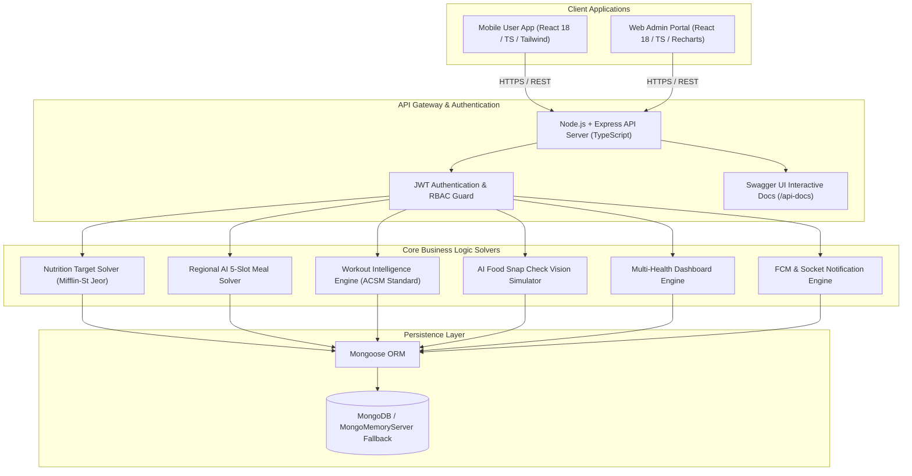
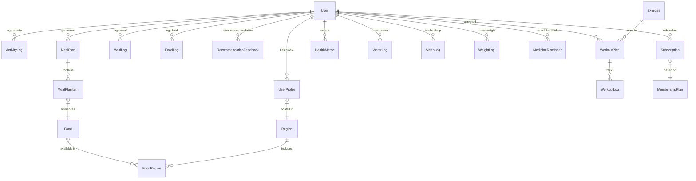

# NutriRegion — Unified Master Technical Documentation & Blueprint

**Project Name:** NutriRegion (Regional AI Personalized Diet & Fitness Assistant)  
**Workspace Root:** `c:\Users\bhush\OneDrive\Desktop\FitnessApp`  
**Document Type:** Master Consolidated Technical Documentation  
**Version:** 3.0 (Unified Master)  
**Date:** September 7, 2026  

---

## 📑 Table of Contents

1. [System Architecture & Core Principles](#1-system-architecture--core-principles)
2. [Database Schemas & Data Models (All 36 Collections)](#2-database-schemas--data-models)
3. [Complete REST API Specifications & OpenAPI Endpoints](#3-complete-rest-api-specifications)
4. [Workout Intelligence Engine Specification](#4-workout-intelligence-engine-specification)
5. [Fixed Exercise Library Rules & Muscle Split Configurations](#5-fixed-exercise-library-rules--muscle-splits)
6. [Master Workout Engine Architecture & Rotation Logic](#6-master-workout-engine-architecture--rotation-logic)
7. [Master Workout Data Generation Prompt (ACSM Rules)](#7-master-workout-data-generation-prompt)
8. [Core Mathematical Solvers & Business Logic Engines](#8-core-mathematical-solvers--business-logic-engines)
9. [Complete Knowledge Transfer (KT) & Handover Guide](#9-complete-knowledge-transfer-kt--handover-guide)
10. [Environment Setup, Local Execution & Deployment Guide](#10-environment-setup-local-execution--deployment-guide)

---

## 🏗️ 1. System Architecture & Core Principles



### Key Architectural Principles
1. **Separation of Concerns**: Clean isolation across Routes -> Controllers -> Services -> Models.
2. **Personalized Nutrition Target Engine**: Implements Mifflin-St Jeor equation deriving BMR & TDEE tailored to user age, height, weight, gender, activity levels, and fitness goals (weight loss, muscle gain, maintenance).
3. **Region-Aware Recommendation Solver**: Multivariable scoring algorithm considering local regional availability ($1\text{--}10$), authentic Indian recipes, macro alignment, user feedback history, and strict allergy/diet exclusions (`veg`, `non_veg`, `eggetarian`).
4. **Workout Intelligence Engine**: ACSM 2026 position stand compliant exercise generator with strict equipment safety checks (rejecting equipment exercises for bodyweight users).
5. **Zero-Config Database Runtime**: Built-in `mongodb-memory-server` fallback inside `backend/src/app.ts` for instant zero-dependency local setup.

---

## 🗄️ 2. Database Schemas & Data Models

The system incorporates **36 Mongoose Collections**. Below are the core collections and relationship models:



### Core Collection Summary
1. **`User`** (`User.ts`): User credentials, role (`user`, `admin`, `super_admin`), status (`active`, `blocked`), last login timestamp.
2. **`UserProfile`** (`UserProfile.ts`): Physical stats, diet preferences, allergies, daily calorie & macro targets, region link.
3. **`Region`** (`Region.ts`): Country, State, City, RegionName hierarchy (e.g. Maharashtra -> Mumbai, Pune, Nagpur).
4. **`Food`** (`Food.ts`): Master food database with per-100g nutritional breakdown, ingredients, recipe instructions.
5. **`FoodRegion`** (`FoodRegion.ts`): Junction collection connecting foods to specific regions with availability score ($1\text{--}10$), authenticity score, and local price.
6. **`MealPlan` & `MealPlanItem`** (`MealPlan.ts`, `MealPlanItem.ts`): 5-slot generated plans (Breakfast, Mid Morning, Lunch, Evening Snack, Dinner) with scaled portion quantities ($g$).
7. **`MealLog` & `FoodLog`**: Consumption logs tracking calories, macros, and timestamped entries.
8. **`RecommendationFeedback`** (`RecommendationFeedback.ts`): Ratings (`liked`, `disliked`, `consumed`, `skipped`) updating recommendation scoring matrix.
9. **`Exercise`** (`Exercise.ts`): Exercise catalog with primary/secondary muscle targets, movement pattern, equipment requirements, difficulty, instructions, substitute exercise IDs, and media URLs.
10. **`WorkoutPlan` & `WorkoutLog`**: Multi-exercise routine definitions linked to live execution logs (duration, total calories, sets/reps completed).
11. **`SnapCheckResult`** (`SnapCheckResult.ts`): Computer vision food recognition logs with confidence score, estimated macros, and ingredient parse lists.
12. **Health Collections**: `WaterLog`, `SleepLog`, `WeightLog`, `ActivityLog`, `MedicineReminder`, `TrackerSettings`.
13. **Monetization & Management**: `MembershipPlan`, `Subscription`, `Payment`, `Trainer`, `TrainerAssignment`, `AuditLog`, `OtpRecord`.

---

## 📡 3. Complete REST API Specifications

Base URL: `http://localhost:5000/api`  
Swagger UI Specs: `http://localhost:5000/api-docs`

### 1. Authentication Endpoints
- **`POST /api/auth/register`**: Register a new user account.
  ```json
  { "name": "Rahul Sharma", "email": "rahul@example.com", "password": "password123" }
  ```
- **`POST /api/auth/login`**: Authenticate credentials and issue JWT access token.

### 2. User Profile & Target Calculation
- **`GET /api/profile`**: Fetch current user profile and target macros.
- **`PUT /api/profile`**: Update physical stats (weight, height, activity level, fitness goal, diet type, allergies) and auto-recalculate target calories & macros.

### 3. Regions & Regional Foods
- **`GET /api/regions`**: Fetch available regional hubs (e.g. Maharashtra -> Mumbai, Pune, Nagpur).
- **`GET /api/foods`**: Search food database by category (`breakfast`, `lunch`, `dinner`, `snack`) and dietary type (`veg`, `non_veg`, `eggetarian`).

### 4. Personalized 5-Slot Meal Plan Generation
- **`POST /api/meal-plans/generate`**: Trigger AI solver to generate today's 5-slot meal plan (Breakfast, Mid Morning, Lunch, Evening Snack, Dinner) matching target macros.
- **`GET /api/meal-plans/today`**: Fetch today's active meal plan along with portion weights ($g$) and "Why Recommended" explanations.

### 5. Workout Intelligence Endpoints
- **`GET /api/workouts/today`**: Retrieve daily target workout routine tailored to user difficulty and equipment constraints.
- **`POST /api/workouts/logs`**: Record completed live workout session log.
- **`GET /api/exercises`**: Search master exercise catalog by muscle target, equipment, and category.

### 6. AI Food Snap Check & Health Trackers
- **`POST /api/snap-check/analyze`**: Submit uploaded photo for AI meal macro detection.
- **`GET /api/progress/analytics?days=7`**: Fetch weight trend line, calorie consumption history, and protein target completion percentage.

### 7. Administrative Portal Endpoints (Admin Only)
- **`GET /api/admin/metrics`**: Fetch platform KPIs, user growth metrics, and regional distribution statistics.
- **`PUT /api/admin/users/:id/status`**: Toggle user account status (`active` / `blocked`).

---

## 🏋️ 4. Workout Intelligence Engine Specification

### System Overview
The Workout Intelligence Engine creates and maintains a comprehensive, production-ready exercise and workout library compliant with the **2026 ACSM resistance-training position stand**.

### 1. Workout Taxonomy
- **Resistance Training**: Full Body, Upper Body, Lower Body, Push, Pull, Legs, Chest, Back, Shoulders, Arms, Biceps, Triceps, Forearms, Glutes, Quads, Hamstrings, Calves, Abs, Core, Posterior Chain.
- **Goal-Based Training**: Muscle Hypertrophy, Strength, Power, General Fitness, Muscular Endurance, Conditioning, Fat-Loss Support, Athletic Performance, Functional Fitness, Mobility.
- **Home Workouts**: No Equipment, Bodyweight, Dumbbell Home Workout, Resistance Band, Kettlebell Home Workout, Jump Rope, Small-Space Workout, Apartment-Friendly Low-Impact, Beginner Home Workout.
- **Gym Workouts**: Machine Workout, Free Weight, Barbell, Dumbbell, Cable, Smith Machine, EZ Bar, Mixed Equipment, Commercial Gym.
- **Special Formats**: 10-Min Quick Workout, 15-Min, 20-Min, 30-Min, 45-Min, 60-Min, 75-Min, Express, Circuit, Superset, AMRAP, EMOM.

### 2. Muscle & Movement Pattern Taxonomy
- **Primary Muscles**: `chest`, `upper_chest`, `mid_chest`, `lower_chest`, `lats`, `upper_back`, `mid_back`, `traps`, `rear_delts`, `front_delts`, `side_delts`, `biceps`, `triceps`, `forearms`, `core`, `abs`, `obliques`, `glutes`, `quads`, `hamstrings`, `calves`.
- **Movement Patterns**: `horizontal_push`, `vertical_push`, `horizontal_pull`, `vertical_pull`, `squat`, `hinge`, `lunge`, `step_up`, `carry`, `rotation`, `anti_rotation`, `anti_extension`, `anti_lateral_flexion`.

### 3. Equipment Safety Rule
> **Equipment Constraint Rule**: If a user selects `Bodyweight` only, the generator must NEVER include barbell, dumbbell, cable, machine, or kettlebell exercises in their routine.

---

## ⚙️ 5. Fixed Exercise Library Rules & Muscle Splits

### Rule 1 — Single Muscle Selection (EXACTLY 9 Exercises)
When the user selects **ONLY ONE MUSCLE**, the system MUST return **EXACTLY 9 exercise options**:
- **Chest**: Barbell Bench Press, Incline Barbell Bench Press, Dumbbell Bench Press, Incline Dumbbell Press, Machine Chest Press, Cable Chest Fly, Pec Deck Fly, Dumbbell Fly, Push-Up.
- **Back**: Lat Pulldown, Pull-Up, Barbell Bent-Over Row, Seated Cable Row, One-Arm Dumbbell Row, Chest-Supported Dumbbell Row, T-Bar Row, Straight-Arm Pulldown, Machine Row.
- **Biceps**: Barbell Curl, EZ-Bar Curl, Dumbbell Curl, Incline Dumbbell Curl, Hammer Curl, Preacher Curl, Cable Curl, Spider Curl, Concentration Curl.
- **Triceps**: Cable Triceps Pushdown, Rope Pushdown, Overhead Cable Extension, Dumbbell Overhead Extension, EZ-Bar Skull Crusher, Dumbbell Skull Crusher, Close-Grip Bench Press, Machine Extension, Single-Arm Cable Extension.
- **Shoulders**: Dumbbell Shoulder Press, Barbell Overhead Press, Arnold Press, Dumbbell Lateral Raise, Cable Lateral Raise, Machine Lateral Raise, Rear Delt Dumbbell Fly, Reverse Pec Deck, Face Pull.
- **Quads**: Barbell Back Squat, Front Squat, Goblet Squat, Leg Press, Bulgarian Split Squat, Walking Lunges, Reverse Lunges, Step-Ups, Leg Extension.
- **Hamstrings**: Romanian Deadlift, Barbell RDL, Dumbbell RDL, Stiff-Leg Deadlift, Lying Leg Curl, Seated Leg Curl, Standing Leg Curl, Nordic Hamstring Curl, Single-Leg RDL.
- **Glutes**: Barbell Hip Thrust, Dumbbell Hip Thrust, Glute Bridge, Bulgarian Split Squat, Reverse Lunge, Walking Lunge, Step-Up, Cable Glute Kickback, Hip Abduction.
- **Calves**: Standing Calf Raise, Seated Calf Raise, Leg Press Calf Raise, Single-Leg Calf Raise, Dumbbell Calf Raise, Machine Calf Raise, Donkey Calf Raise, Bodyweight Calf Raise, Single-Leg Seated Calf Raise.
- **Abs / Core**: Plank, Side Plank, Cable Crunch, Reverse Crunch, Hanging Knee Raise, Hanging Leg Raise, Dead Bug, Bicycle Crunch, Pallof Press.

### Rule 2 & 3 — Double Muscle Selection (5 + 4 = 9 TOTAL)
When selecting **TWO MUSCLES**, return **EXACTLY 9 exercises TOTAL** (5 for Primary Muscle, 4 for Secondary Muscle):
1. **Chest + Triceps** (Chest = 5, Triceps = 4, Total = 9)
2. **Back + Biceps** (Back = 5, Biceps = 4, Total = 9)
3. **Legs + Shoulders** (Legs = 5, Shoulders = 4, Total = 9)

---

## 🔄 6. Master Workout Engine Architecture & Rotation Logic

### Actual Session vs. Available Exercise Pool
The engine distinguishes the **Available Exercise Pool** (8–12 selectable choices) from **Today's Actual Session** (3–6 recommended exercises based on session duration).

```json
{
  "workoutPlan": {
    "workoutId": "custom_plan_123",
    "title": "CHEST + TRICEPS ROUTINE",
    "selectedMuscles": ["chest", "triceps"],
    "splitType": "two_muscle",
    "goal": "hypertrophy",
    "estimatedDurationMin": 45,
    "totalCaloriesBurn": 280,
    "nextWorkoutRecommendation": {
      "recommended": true,
      "reason": "You trained Chest & Triceps today. Recommend Back & Biceps tomorrow for optimal recovery.",
      "focusArea": "BACK + BICEPS",
      "muscles": ["back", "biceps"]
    }
  }
}
```

### Tomorrow Recommendation Engine
Upon session completion:
1. Log `todayWorkout.primaryMuscles` and `todayWorkout.secondaryMuscles`.
2. Compute opposing / unworked muscle groups for tomorrow:
   - **Chest + Triceps** today -> Recommend **Back + Biceps** tomorrow.
   - **Back + Biceps** today -> Recommend **Legs (Quads / Hamstrings / Glutes)** tomorrow.
   - **Legs** today -> Recommend **Shoulders + Core** or **Chest + Triceps** tomorrow.

---

## 🤖 7. Master Workout Data Generation Prompt

Below is the official prompt for generating ACSM-compliant JSON workout plans:

```text
You are an expert ACSM-Certified Exercise Physiologist and Data Engineer for the NUTRIREGION Fitness Application.
Generate a comprehensive, production-ready Workout Plan in raw JSON format matching the input parameters below.

INPUT PARAMETERS:
- Goal: [TARGET_GOAL] ("hypertrophy", "strength", "fat_loss", "general_fitness")
- Experience Level: [EXPERIENCE_LEVEL] ("beginner", "intermediate", "advanced")
- Target Focus Area: [FOCUS_AREA] (e.g., "Lower Body Strength", "Upper Body Push")
- Available Equipment: [AVAILABLE_EQUIPMENT] (e.g., ["Dumbbell", "Barbell", "Bodyweight"])
- Workout Duration: [WORKOUT_DURATION_MIN] minutes (15, 30, 45, 60, 75)
- Target Day: [TARGET_DAY] ("monday", "tuesday", etc.)

ACSM TRAINING LOGIC RULES:
1. Hypertrophy: 3-4 sets, 8-12 reps, 45-60s rest.
2. Strength & Power: 3-5 sets, 4-6 reps (heavy load), 90-180s rest.
3. Fat Loss / Conditioning: 3-4 sets, 12-15 reps, 30-45s rest.
4. General Fitness: 3 sets, 10-12 reps, 45-60s rest.

CALORIE CALCULATION FORMULA (75 kg standard body weight):
- High Intensity / HIIT: MET ~8.0 -> ~10 kcal/min
- Moderate Resistance / Hypertrophy: MET ~6.0 -> ~7.5 kcal/min
- Light / Mobility / Core: MET ~4.0 -> ~5.0 kcal/min
Total Calories Burn = DurationMinutes * MET_kcal_rate
```

---

## 📐 8. Core Mathematical Solvers & Business Logic Engines

### A. Mifflin-St Jeor BMR & Target Macros (`nutritionService.ts`)
```typescript
export function calculateBMR(stats: { gender: string; weightKg: number; heightCm: number; age: number }): number {
  const genderOffset = stats.gender === 'female' ? -161 : 5;
  return 10 * stats.weightKg + 6.25 * stats.heightCm - 5 * stats.age + genderOffset;
}

export function calculateTDEE(bmr: number, activityLevel: string): number {
  const multipliers: Record<string, number> = {
    sedentary: 1.2, lightly_active: 1.375, moderately_active: 1.55, very_active: 1.725
  };
  return bmr * (multipliers[activityLevel] || 1.2);
}

export function calculateTargetMacros(tdee: number, goal: string, weightKg: number) {
  let targetCalories = tdee;
  if (goal === 'weight_loss') targetCalories -= 500;
  else if (goal === 'muscle_gain') targetCalories += 400;

  const proteinG = Math.round(weightKg * 2.0);
  const fatsG = Math.round((targetCalories * 0.25) / 9);
  const carbsG = Math.round((targetCalories - (proteinG * 4 + fatsG * 9)) / 4);

  return { targetCalories, proteinG, carbsG, fatsG };
}
```

### B. Multi-Variable Regional AI Scorer (`personalizationEngine.ts`)
$$\text{Score} = (35\% \cdot \text{Macro Alignment}) + (25\% \cdot \text{Regional Availability}) + (20\% \cdot \text{Preference Fit}) + (20\% \cdot \text{Feedback History})$$

### C. 5-Slot Portion Weight Solver (`mealPlanGenerator.ts`)
$$\text{Slot Target Calories} = \text{Target Calories} \times \text{Slot Percentage}$$
$$\text{Portion Weight } (g) = \text{Clamp}\left( \frac{\text{Slot Target Calories}}{\text{Food Calories per 100g}} \times 100, \, 50g, \, 600g \right)$$
*(Slot Distribution: Breakfast 25%, Mid Morning 10%, Lunch 35%, Evening Snack 10%, Dinner 20%)*

---

## 🎓 9. Complete Knowledge Transfer (KT) & Handover Guide

### Project Work Status
- **Backend API Service**: 100% Completed (18 routes, 36 models, seed script, Swagger UI).
- **Mobile User App**: 100% Completed (17 screens, 37 dynamic components, live tracker modal, health trackers).
- **Web Admin Portal**: 100% Completed (Dashboard charts, user status controls, food/exercise CRUD).

### Key Repository Files Reference
- **Backend Entry**: [`backend/src/app.ts`](file:///c:/Users/bhush/OneDrive/Desktop/FitnessApp/backend/src/app.ts)
- **Database Seeder**: [`backend/src/seed.ts`](file:///c:/Users/bhush/OneDrive/Desktop/FitnessApp/backend/src/seed.ts)
- **Nutrition Solver**: [`backend/src/services/nutritionService.ts`](file:///c:/Users/bhush/OneDrive/Desktop/FitnessApp/backend/src/services/nutritionService.ts)
- **Meal Generator**: [`backend/src/services/mealPlanGenerator.ts`](file:///c:/Users/bhush/OneDrive/Desktop/FitnessApp/backend/src/services/mealPlanGenerator.ts)
- **Workout Generator**: [`backend/src/services/workoutGeneratorService.ts`](file:///c:/Users/bhush/OneDrive/Desktop/FitnessApp/backend/src/services/workoutGeneratorService.ts)
- **Mobile Entry**: [`mobile/src/App.tsx`](file:///c:/Users/bhush/OneDrive/Desktop/FitnessApp/mobile/src/App.tsx)
- **Live Workout Tracker**: [`mobile/src/components/LiveWorkoutTrackerModal.tsx`](file:///c:/Users/bhush/OneDrive/Desktop/FitnessApp/mobile/src/components/LiveWorkoutTrackerModal.tsx)
- **Admin Dashboard**: [`admin/src/pages/DashboardOverview.tsx`](file:///c:/Users/bhush/OneDrive/Desktop/FitnessApp/admin/src/pages/DashboardOverview.tsx)

---

## 🛠️ 10. Environment Setup, Local Execution & Deployment Guide

### Environment Configuration (`.env`)
```env
PORT=5000
MONGODB_URI=mongodb://localhost:27017/fitnessapp
JWT_SECRET=super_secret_jwt_key_nutriregion_2026
NODE_ENV=development
```

### Local Development Commands
```bash
# 1. Start Backend API Server (http://localhost:5000)
cd backend && npm install && npm run dev

# 2. Start Mobile User App (http://localhost:3000)
cd mobile && npm install && npm run dev

# 3. Start Web Admin Portal (http://localhost:3001)
cd admin && npm install && npm run dev
```

### Credentials for Testing
- **Demo User Account**: Email: `rahul@example.com` | Password: `password123`
- **Admin Account**: Email: `admin@fitnessapp.com` | Password: `password123`

---
*End of NutriRegion Unified Master Technical Documentation.*
